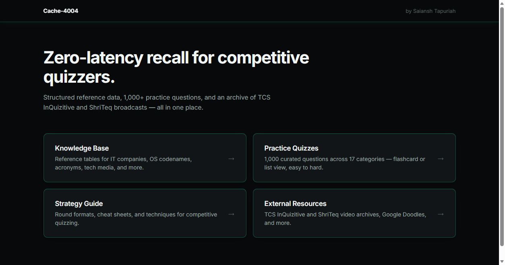
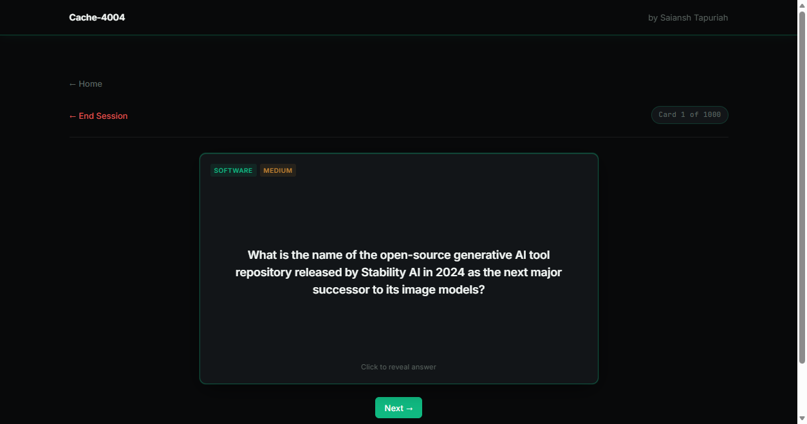
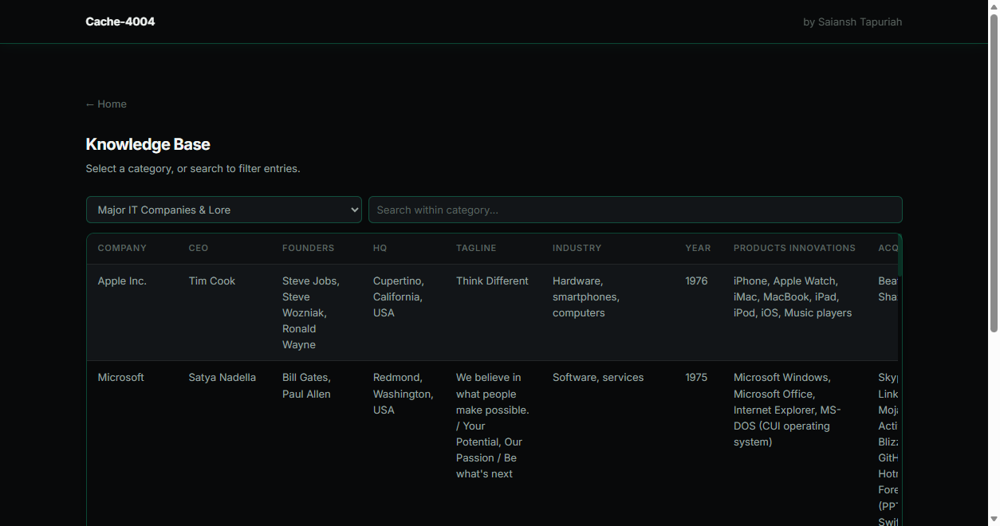

<p align="center">
  <h1 align="center">Cache-4004</h1>
  <p align="center"><strong>Zero-Latency Tech Recall & Knowledge Engine for Competitive Quizzers</strong></p>
  <p align="center">
    <a href="https://saiansht.github.io/Cache-4004/"></a>
    
    
  </p>
</p>

<p align="center">
  
</p>

---

## Problem & Motivation

Participants in high-stakes competitive Science and Technology Quizzing—such as **TCS InQuizitive**, **ShriTeq**, and premier national school circuits—face high-pressure buzzer rounds where rapid factual recall and pattern recognition make the difference between victory and elimination. 

Traditional revision resources suffer from acute limitations:
1. **Framework Bloat & Network Latency:** Modern web flashcard platforms rely on heavy JavaScript bundles, tracking scripts, and remote database lookups that introduce frustrating lag when quizzers need rapid-fire review.
2. **Scattered Domain Knowledge:** Niche technological lore—such as OS codenames (Windows, Android, macOS), semiconductor architectures, corporate acquisitions, tech etymology, and founder trivia—is scattered across decades of disparate Wikipedia entries and YouTube broadcast archives.
3. **Rigid Drill Formats:** Existing quiz apps lack flexible study modes tailored to both long-form reference studying and dynamic flashcard drills.

---

## Solution Overview

**Cache-4004** is a zero-dependency, ultra-fast web study hub designed specifically for competitive tech quizzers. 

Built with pure Vanilla HTML5, CSS3, and ES6+ JavaScript, Cache-4004 requires zero build steps, zero package managers, and zero external frameworks. It provides instant client-side retrieval across a curated database of **1,000 verified questions** and **6 structured reference tables**, accompanied by a non-repeating **Fisher-Yates algorithmic flashcard engine** and competition strategy guides.

---

## Real-World Impact & Active Mentorship

Cache-4004 served as the primary preparation engine and mentorship hub for both teams representing The Shri Ram School at **ShriTeq** (one of India's premier inter-school technology symposiums):
- **Adoption:** Deployed and actively utilized by 6 student delegates across both the Senior (3 students) and Junior (3 students) quizzing delegations.
- **Outcome:** **Both teams won 1st Place**, sweeping both division championships.

---

## Key Features & Study Modes

<table align="center" width="100%">
  <thead>
    <tr>
      <th width="25%">Feature Module</th>
      <th width="75%">Capability & Engineering Details</th>
    </tr>
  </thead>
  <tbody>
    <tr>
      <td><strong>Knowledge Base</strong></td>
      <td>Structured, searchable reference datasets covering IT multinational corporate histories, founders, CEOs, acquisitions, Indian startup ecosystems, OS codenames, hardware trivia, and tech media.</td>
    </tr>
    <tr>
      <td><strong>Practice Quizzes</strong></td>
      <td><strong>1,000 curated Q&A pairs</strong> spanning 17 technical categories with multi-attribute filtering by category and difficulty.</td>
    </tr>
    <tr>
      <td><strong>Flashcard Mode</strong></td>
      <td>Interactive card flip session powered by an in-place <strong>Fisher-Yates shuffle algorithm</strong> ensuring mathematically uniform, repeat-free study runs.</td>
    </tr>
    <tr>
      <td><strong>List View Mode</strong></td>
      <td>High-density paginated list with click-to-reveal answers, designed for rapid-fire cramming and team quizzing practice.</td>
    </tr>
    <tr>
      <td><strong>Strategy & Broadcast Archives</strong></td>
      <td>Curated strategy guides covering round formats, buzzer timing, and direct links to historical TCS InQuizitive and ShriTeq broadcast archives.</td>
    </tr>
  </tbody>
</table>

<p align="center">
  &nbsp;
  
</p>
<p align="center"><em>Left: Fisher-Yates shuffled flashcard study interface. Right: Searchable structured knowledge base reference tables.</em></p>

---

## Database Scope & Architecture

### 1. Curated Question Bank (`quiz.json`)
The platform indexes **1,000 verified questions** balanced across three difficulty tiers:

| Tier | Question Count | Target Competency |
|---|:---:|---|
| 🟢 **Easy** | 312 | Fundamental computer science trivia, foundational company lore, mainstream acronyms |
| 🟡 **Medium** | 446 | Regional finals standards, niche acquisitions, semiconductor codenames, startup history |
| 🔴 **Hard** | 242 | National finals standards, obscure engineering etymology, historical computing milestones |

**17 Distinct Categories:** IT Companies, Tech History, Acronyms, Books, Crypto, Cybersecurity, Emerging Tech, Hardware, India Tech, Movies, Programming, Robotics, Software, Space Tech, Sports Tech, Tech Personalities, and Video Games.

### 2. Structured Knowledge Tables (`knowledgebase.json`)
- **Corporate Lore:** Major IT conglomerates (Founders, CEOs, Global HQs, Key acquisitions, Iconic taglines).
- **Indian Startup Ecosystem:** Unicorns, founders, core offerings, parent companies.
- **Operating System & Chip Codenames:** Windows, Android, Intel Processor families, Apple macOS releases.
- **Tech Acronyms:** Networking, hardware protocols, enterprise infrastructure, corporate jargon.
- **Literature & Media:** Books authored by technology leaders, sci-fi novels, cult technology films and documentaries.

---

## Technical Architecture & Engineering Philosophy

- **Zero-Dependency Single Page Application (SPA):** By eliminating heavy client frameworks (React/Vue/Angular), Cache-4004 achieves sub-50ms first-contentful paint and instant transitions handled entirely via CSS visibility state machines.
- **Algorithmic Deck Shuffling:** Implements an unbiased Fisher-Yates ($O(n)$) shuffling routine on the client-side array, guaranteeing true random order without duplicate card presentation.
- **High-Performance Client Filtering:** Instantaneous multi-category and multi-difficulty slicing performed in-memory without server round-trips.

---

## Repository Structure

```text
Cache-4004/
├── images/
│   ├── cache4004_hub_dashboard.png        # Platform dashboard hero view
│   ├── cache4004_flashcard_mode.png       # Interactive flashcard view
│   └── cache4004_knowledge_base.png       # Structured reference table view
├── app.js                                 # SPA routing, quiz engine & Fisher-Yates logic
├── index.html                             # Zero-dependency semantic HTML5 shell
├── knowledgebase.json                     # Structured reference datasets (companies, codenames)
├── quiz.json                              # 1,000 categorized Q&A pairs
├── style.css                              # Hand-crafted dark cyber/terminal CSS design system
└── README.md
```

---

## Live Deployment

Access the live production deployment anytime at **[saiansht.github.io/Cache-4004](https://saiansht.github.io/Cache-4004/)**.

---

## Author & Credits

- **Author & Maintainer:** Saiansh Tapuriah (`SaianshT`)
- **Live Deployment:** GitHub Pages
